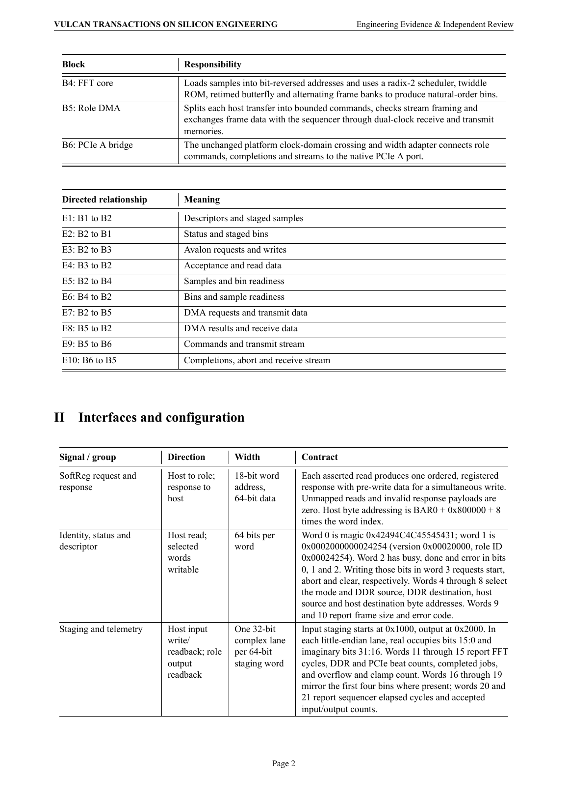
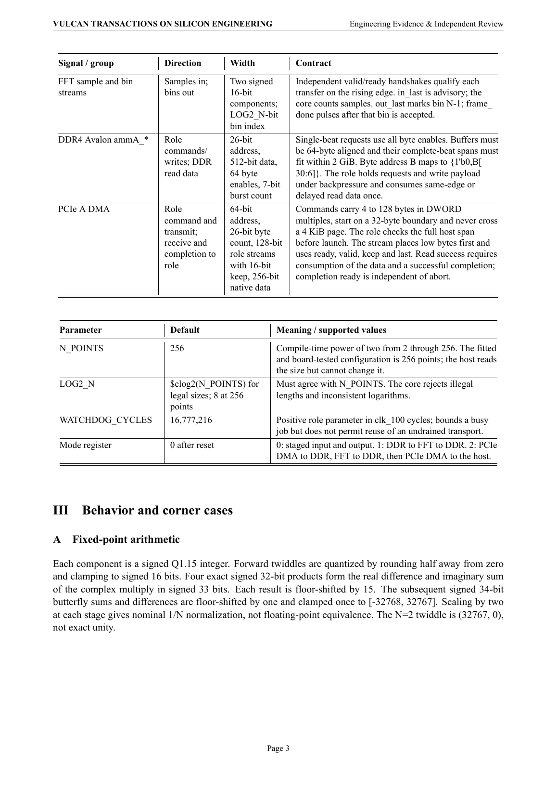

<div align="center">
  <picture>
    <source media="(prefers-color-scheme: dark)" srcset="brand/logo-dark.svg">
    
  </picture>
  <h1>Billet-T · Spectral FFT/IFFT & Frequency-Domain Signal Processing Silicon</h1>
  <p><strong>Synthesizable 100 MHz+ Complex Radix-2 FFT Butterfly & Ping-Pong Frame Engines · Intel Arria 10 GX HIL</strong></p>
  <p>
    
    
    
    
    
  </p>
  <p>
    <a href="https://github.com/aHappend/vulcan-showcase"><strong>Vulcan Showcase</strong></a> · <a href="https://github.com/aHappend/anvil-q">Anvil-Q (LLM)</a> · <a href="https://github.com/aHappend/anvil-e">Anvil-E (Embed)</a> · <a href="https://github.com/aHappend/anvil-en">Anvil-EN (Gemma)</a> · <a href="https://github.com/aHappend/anvil-d">Anvil-D (MLA/MoE)</a> · <a href="https://github.com/aHappend/anvil-qn">Anvil-QN (Qwen3)</a> · <a href="https://github.com/aHappend/bellows-l">Bellows-L</a> · <a href="https://github.com/aHappend/bellows-n">Bellows-N</a> · <a href="https://github.com/aHappend/billet-f">Billet-F</a> · <a href="https://github.com/aHappend/billet-t">Billet-T</a> · <a href="https://github.com/aHappend/crucible-g">Crucible-G</a> · <a href="https://github.com/aHappend/furnace-x">Furnace-X</a> · <a href="https://github.com/aHappend/hammer-v">Hammer-V</a> · <a href="https://github.com/aHappend/rivet-a">Rivet-A</a> · <a href="https://github.com/aHappend/rivet-h">Rivet-H</a> · <a href="https://github.com/aHappend/swage-s">Swage-S</a> · <a href="https://github.com/aHappend/sable">SABLE</a> · <a href="README.zh-CN.md"><strong>简体中文</strong></a>
  </p>
</div>

---

**Billet-T** is the spectral transform line in the Vulcan silicon fleet, featuring full-shell silicon-verified 256-point Radix-2 complex FFT acceleration (`BILLET-T1`) on Intel Arria 10 GX.

## Vulcan 3.0 Full-Shell Silicon Signoff Matrix

All chips in `chips/` are synthesized, placed, routed, and timing-closed inside the **complete Intel Arria 10 GX PCIe Gen3x8 + DDR4-2133 platform shell** (`10AX115N3F40E2SG`, Quartus Prime Standard `17.1.0`) and executed bit-exact on physical board hardware (`board_hil`) alongside matched `AMD EPYC 7662` CPU and `NVIDIA Tesla V100` GPU baselines.

| Generation | Chip | Architecture & Verification Scope | Full-Shell 4-Corner STA | Whole-Shell Utilization (`10AX115`) | Physical Board HIL | Deliverables |
| :--- | :--- | :--- | :--- | :--- | :--- | :--- |
| **Gen-1 (v3.0)** | [**BILLET-T1**](chips/billet-t1/README.md) | 256-point fixed-point Radix-2 complex FFT · Ping-pong frame SRAM, bit-reversal addressing & twiddle butterfly pipeline | **`132.96 MHz`** (`WNS +2.479 ns`)<br><sub>PCIe `278.24` · DDR4 `276.78 MHz`</sub> | `42,670 ALMs (10 %)`<br><sub>`3 DSPs` · `189 M20K`</sub> | **PASSED**<br><sub>PCIe Gen3x8 + DDR4</sub> | [**`REPORT.pdf`**](chips/billet-t1/REPORT.pdf) · [RTL](chips/billet-t1/rtl/) · [Evidence](chips/billet-t1/evidence/) |

## Engineering Report Visual Preview

### BILLET-T1 · Vulcan 3.0 Engineering Report Preview ([`chips/billet-t1/REPORT.pdf`](chips/billet-t1/REPORT.pdf))
<table>
  <tr>
    <td align="center" width="33%"><a href="chips/billet-t1/REPORT.pdf"></a><br><sub><strong>Page 1 · Executive Summary &amp; Architecture</strong></sub></td>
    <td align="center" width="33%"><a href="chips/billet-t1/REPORT.pdf"></a><br><sub><strong>Page 2 · Microarchitecture &amp; Verification</strong></sub></td>
    <td align="center" width="33%"><a href="chips/billet-t1/REPORT.pdf"></a><br><sub><strong>Page 3 · Full-Shell STA, HIL &amp; Benchmarks</strong></sub></td>
  </tr>
</table>

## Repository Structure

```text
billet-t/
├── README.md               # Formal English documentation
├── README.zh-CN.md         # Formal Simplified Chinese documentation
├── brand/                  # Light/dark vector identity assets
├── chips/
│   ├── billet-t1/             # BILLET-T1 (RTL, tests, STA/HIL receipts, REPORT.pdf)
├── archive-v2/             # Pre-3.0 historical design snapshots
└── LICENSE                 # MIT License
```

---
<p align="center"><sub>Author: <strong>Sufeng Guo</strong> · <a href="https://github.com/aHappend/vulcan-showcase">Vulcan Silicon Showcase</a> · <a href="LICENSE">MIT License</a></sub></p>
