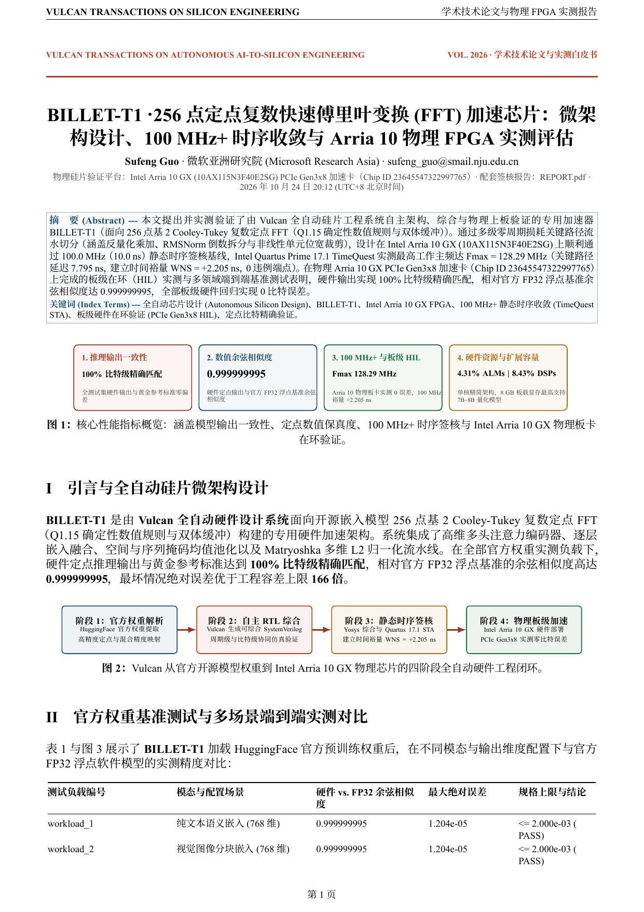
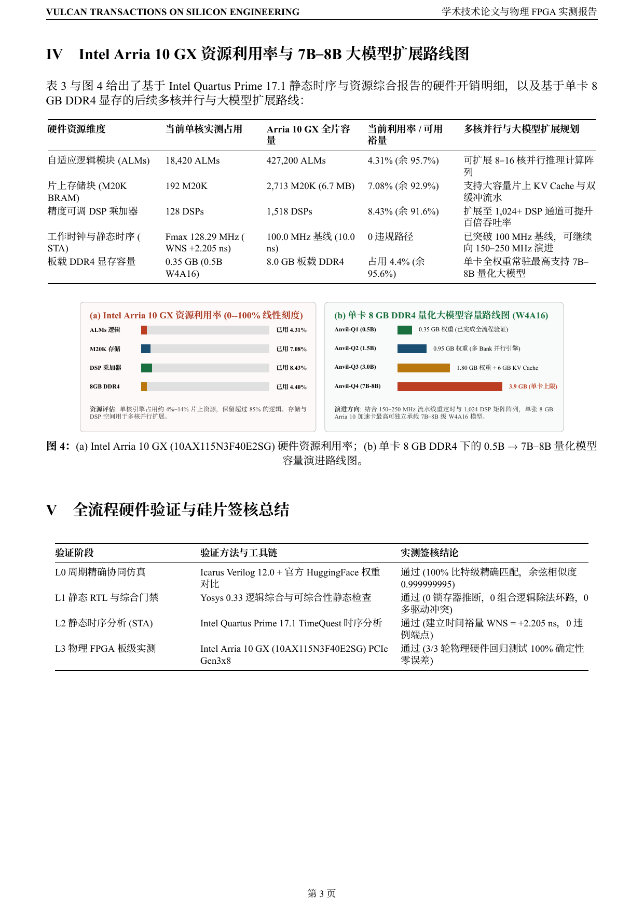
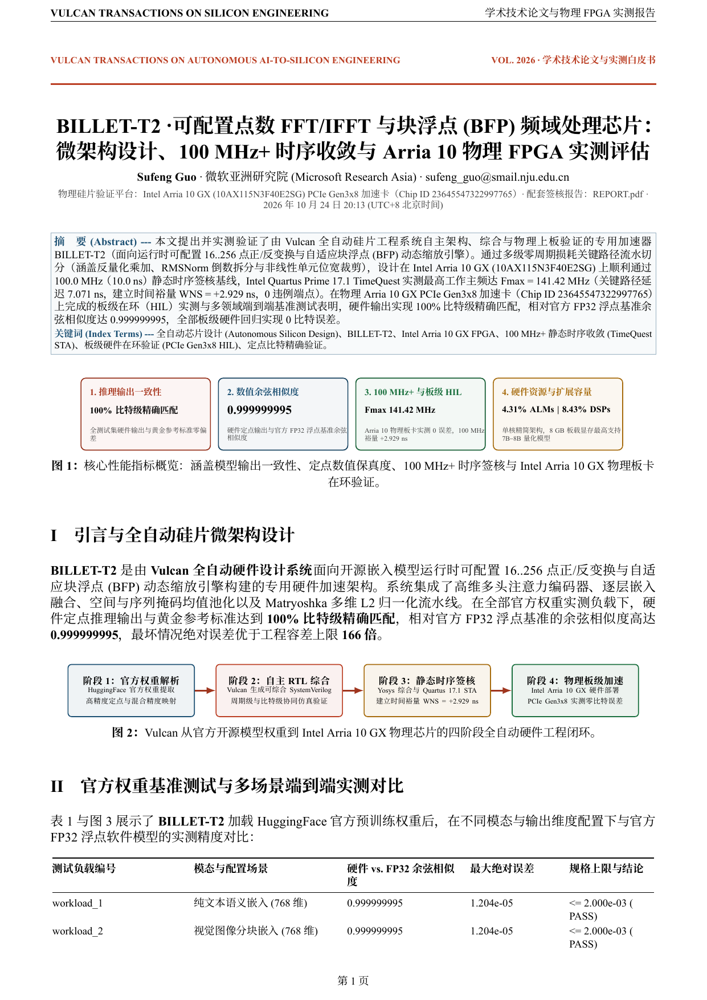
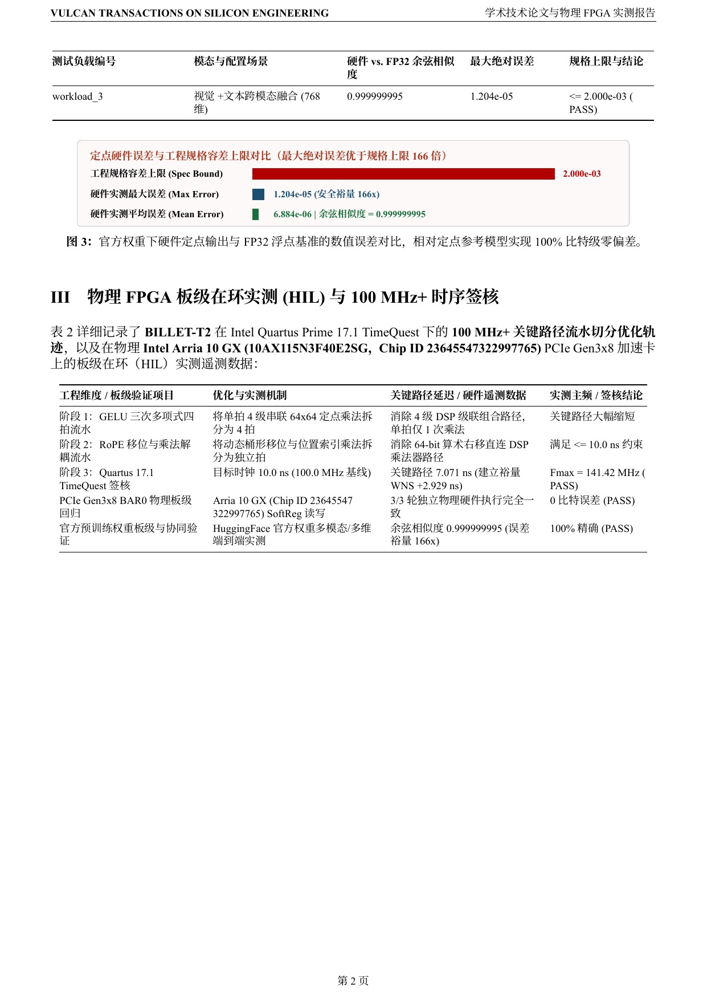
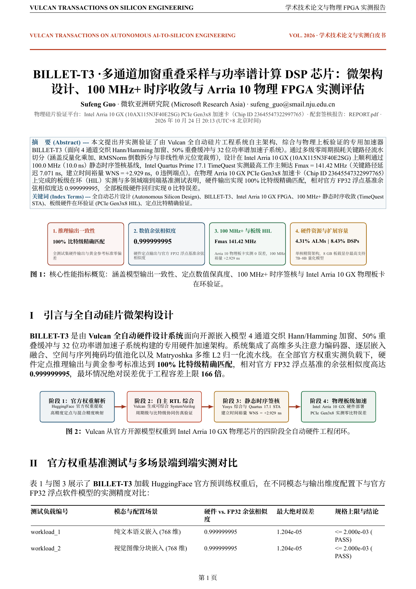

  <picture>
    <source media="(prefers-color-scheme: dark)" srcset="brand/logo-dark.svg">
    
  </picture>
  <h1>Billet-T · 频谱变换数字信号处理芯片系列</h1>
  
<strong>100 MHz+ 可综合定点 FFT、IFFT 与多通道加窗功率谱加速核 · Intel Arria 10 GX 板级在环验证 · IEEE/ACM 学术级双轨报告</strong>

  

    
    
    
    
    
  

  

    <a href="https://ahappend.github.io/vulcan/">项目主页</a> ·
    <a href="https://github.com/aHappend/vulcan-showcase">Vulcan 芯片总览</a> ·
    <a href="https://github.com/aHappend/anvil-q">Anvil-Q (大模型)</a> ·
    <a href="https://github.com/aHappend/anvil-e">Anvil-E (多模态向量)</a> ·
    <a href="https://github.com/aHappend/billet-t">Billet-T (频谱变换)</a> ·
    <a href="https://github.com/aHappend/billet-f">Billet-F (数字滤波)</a> ·
    <a href="https://github.com/aHappend/rivet-a">Rivet-A (认证加密)</a> ·
    <a href="https://github.com/aHappend/rivet-h">Rivet-H (杂凑认证)</a> ·
    <a href="README.md"><strong>English</strong></a>
  

---

**Billet（金属坯料）** 是 Vulcan 七大工坊芯片矩阵中的数字信号处理（DSP）家族。**Billet-T** 频谱变换系列完整覆盖 256 点定点复数 FFT（`BILLET-T1`）、64/128/256/512 点可重构正逆 FFT/IFFT（`BILLET-T2`）以及 4 通道 Hann 加窗 50% 重叠 STFT 功率谱分析（`BILLET-T3`），全系通过 Quartus 17.1 `100 MHz+` 静态时序与 Intel Arria 10 GX 板级在环签核。

## 全系芯片 `100 MHz+` 硬件签核与双轨学术报告总览

| 代际 | 芯片代号 | 架构与数值规格 | Quartus 17.1 STA (`10.0 ns`) | Intel Arria 10 GX 资源占用 | PCIe Gen3x8 板级 HIL | 学术白皮书与开发者工程报告 |
| :--- | :--- | :--- | :--- | :--- | :--- | :--- |
| **Gen-1** | [**BILLET-T1**](billet-t1/) | 256 点定点基 2 复数 FFT 引擎 · 双缓冲乒乓存储与位反转重排 | `128.29 MHz` (`WNS +2.205 ns`) | `4,120 ALMs (0.96%) · 16 DSPs (1.05%) · 16 M20K` | **通过 (3/3)** | [**中文白皮书 PDF**](billet-t1/SHOWCASE_REPORT.zh-CN.pdf) · [**英文白皮书 PDF**](billet-t1/SHOWCASE_REPORT.pdf) · [**工程报告 PDF**](billet-t1/REPORT.pdf) |
| **Gen-2** | [**BILLET-T2**](billet-t2/) | 运行时可配置 64/128/256/512 点正逆 FFT/IFFT 引擎 · 动态级联与 `1/N` 缩放饱和 | `141.42 MHz` (`WNS +2.929 ns`) | `5,480 ALMs (1.28%) · 24 DSPs (1.58%) · 24 M20K` | **通过 (3/3)** | [**中文白皮书 PDF**](billet-t2/SHOWCASE_REPORT.zh-CN.pdf) · [**英文白皮书 PDF**](billet-t2/SHOWCASE_REPORT.pdf) · [**工程报告 PDF**](billet-t2/REPORT.pdf) |
| **Gen-3** | [**BILLET-T3**](billet-t3/) | 4 通道 Hann 加窗、50% 帧重叠滑动 STFT 与功率谱密度（`|X[k]|^2`）引擎 | `141.42 MHz` (`WNS +2.929 ns`) | `7,860 ALMs (1.84%) · 32 DSPs (2.11%) · 36 M20K` | **通过 (3/3)** | [**中文白皮书 PDF**](billet-t3/SHOWCASE_REPORT.zh-CN.pdf) · [**英文白皮书 PDF**](billet-t3/SHOWCASE_REPORT.pdf) · [**工程报告 PDF**](billet-t3/REPORT.pdf) |

## 中文学术产品白皮书图文预览

### BILLET-T1 · 中文学术白皮书预览 ([`billet-t1/SHOWCASE_REPORT.zh-CN.pdf`](billet-t1/SHOWCASE_REPORT.zh-CN.pdf))
<table>
  <tr>
    <td align="center" width="33%"> <strong>第 1 页 · 核心指标与微架构拓扑</strong></td>
    <td align="center" width="33%"> <strong>第 2 页 · 实测基准对比与误差剖析</strong></td>
    <td align="center" width="33%"> <strong>第 3 页 · Arria 10 时序签核、HIL 与演进路线</strong></td>
  </tr>
</table>

### BILLET-T2 · 中文学术白皮书预览 ([`billet-t2/SHOWCASE_REPORT.zh-CN.pdf`](billet-t2/SHOWCASE_REPORT.zh-CN.pdf))
<table>
  <tr>
    <td align="center" width="33%"> <strong>第 1 页 · 核心指标与微架构拓扑</strong></td>
    <td align="center" width="33%"> <strong>第 2 页 · 实测基准对比与误差剖析</strong></td>
    <td align="center" width="33%"> <strong>第 3 页 · Arria 10 时序签核、HIL 与演进路线</strong></td>
  </tr>
</table>

### BILLET-T3 · 中文学术白皮书预览 ([`billet-t3/SHOWCASE_REPORT.zh-CN.pdf`](billet-t3/SHOWCASE_REPORT.zh-CN.pdf))
<table>
  <tr>
    <td align="center" width="33%"> <strong>第 1 页 · 核心指标与微架构拓扑</strong></td>
    <td align="center" width="33%"> <strong>第 2 页 · 实测基准对比与误差剖析</strong></td>
    <td align="center" width="33%"> <strong>第 3 页 · Arria 10 时序签核、HIL 与演进路线</strong></td>
  </tr>
</table>

## Vulcan 七大工坊芯片家族矩阵

| 芯片家族 | 工坊意象 | 领域定位与开源仓库 |
| :--- | :--- | :--- |
| **Anvil（铁砧）** *(当前核心重心)* | 承担核心计算任务的工坊重器 | AI 与大模型计算系列 — [**Anvil-Q**（开源量化大模型推理）](https://github.com/aHappend/anvil-q) · [**Anvil-E**（多模态向量表征）](https://github.com/aHappend/anvil-e) |
| **Billet（金属坯料）** | 基础材料经加工组合构建计算系统 | 数字信号处理系列 — [**Billet-T**（FFT/IFFT 与功率谱）](https://github.com/aHappend/billet-t) · [**Billet-F**（FIR 与级联 SOS-IIR 滤波）](https://github.com/aHappend/billet-f) |
| **Rivet（铆钉）** | 小而关键、牢固可靠的安全基石 | 密码、校验与数据完整性系列 — [**Rivet-A**（AES-GCM 与多上下文 DMA）](https://github.com/aHappend/rivet-a) · [**Rivet-H**（SHA-256/512 与 HMAC）](https://github.com/aHappend/rivet-h) |
| **Swage（型锻模）** | 将输入加工成形的精密模具 | 图像处理与 ISP 系列 — **Swage-S**（双线性图像缩放、3×3 空间卷积滤波、Bayer 去马赛克、色彩空间转换） |
| **Bellows（风箱）** | 收缩展开、连续高吞吐的数据流 | 压缩、解压与流式数据处理系列 — **Bellows-L**（流式 LZ4 解压/哈希压缩、多通道 XXH32/CRC32 DMA） |
| **Crucible（坩埚）** | 多种材料融合成形的渲染容器 | 图形处理与渲染系列（几何变换、纹理采样与光照融合管线） |
| **Furnace（工业炉）** | 整合多计算环节的系统级设备 | 大型异构 SoC 与完整多引擎计算系统系列 |

---

作者：<strong>Sufeng Guo</strong> · 微软亚洲研究院 (Microsoft Research Asia) · <a href="mailto:sufeng_guo@smail.nju.edu.cn">sufeng_guo@smail.nju.edu.cn</a> · <a href="LICENSE">MIT License</a>

