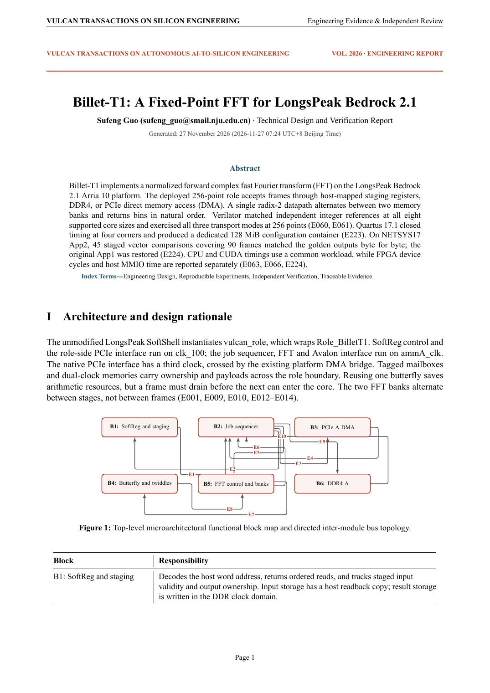
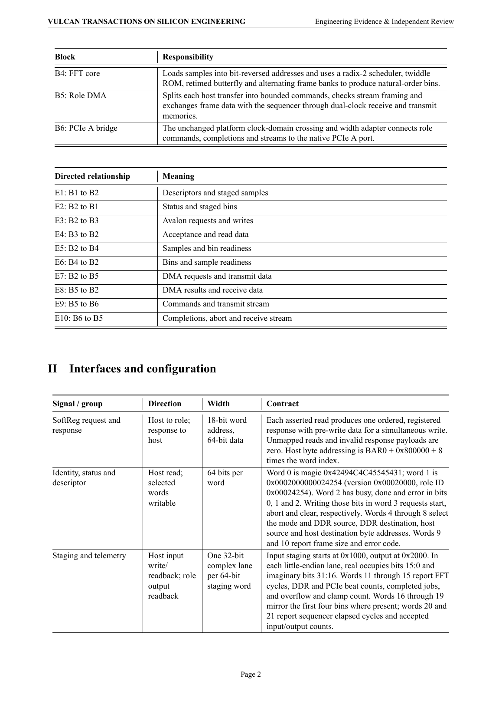
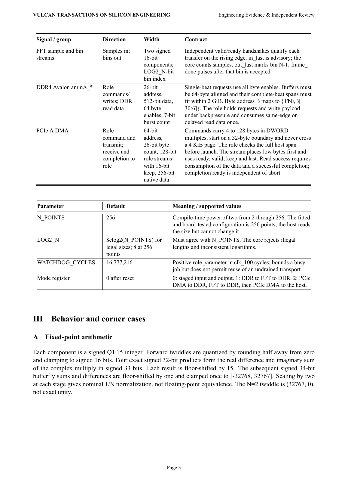

<div align="center">
  <picture>
    <source media="(prefers-color-scheme: dark)" srcset="brand/logo-dark.svg">
    
  </picture>
  <h1>Billet-T · 频谱变换与快速傅里叶处理芯片家族</h1>
  <p><strong>可综合 100 MHz+ 定点基-2 FFT/IFFT 与频谱加速引擎 · Intel Arria 10 GX 全壳静态时序收敛与 PCIe Gen3x8 物理板级闭环验证</strong></p>
  <p>
    
    
    
    
    
  </p>
  <p>
    <a href="https://github.com/aHappend/vulcan-showcase"><strong>Vulcan 总览</strong></a> · <a href="https://github.com/aHappend/bellows-l">Bellows-L (LZ4)</a> · <a href="https://github.com/aHappend/billet-t">Billet-T (FFT)</a> · <a href="https://github.com/aHappend/billet-f">Billet-F (FIR)</a> · <a href="https://github.com/aHappend/crucible-g">Crucible-G (3D)</a> · <a href="https://github.com/aHappend/furnace-x">Furnace-X (DMA/CRC)</a> · <a href="https://github.com/aHappend/hammer-v">Hammer-V (RISC-V)</a> · <a href="https://github.com/aHappend/rivet-a">Rivet-A (AES-GCM)</a> · <a href="https://github.com/aHappend/rivet-h">Rivet-H (SHA-256)</a> · <a href="https://github.com/aHappend/swage-s">Swage-S (ISP)</a> · <a href="https://github.com/aHappend/sable">SABLE</a> · <a href="README.md"><strong>English</strong></a>
  </p>
</div>

---

**Billet-T** 是 Billet 数字信号处理家族的频域变换产品线，集成位反转乒乓帧缓存调度、旋转因子 ROM 复数蝶形运算流水线与 PCIe/DDR4 帧级 DMA（`BILLET-T1`）。

## Vulcan 3.0 全壳物理上板签核总表

`chips/` 目录下的所有芯片均在 **完整 Intel Arria 10 GX PCIe Gen3x8 + DDR4-2133 平台外壳**（`10AX115N3F40E2SG`，Quartus Prime Standard `17.1.0`）内完成布局布线与四温度电压角静态时序闭合，并通过真实物理板卡上板闭环测试（`board_hil`）以及同机 `AMD EPYC 7662` CPU 与 `NVIDIA Tesla V100` GPU 同口径基准测试。

| 代际 | 芯片代号 | 微架构与工程验证范围 | 全壳四角静态时序（STA） | 含外壳整芯片资源占用 | 物理板卡上板（HIL） | 公开工程交付物 |
| :--- | :--- | :--- | :--- | :--- | :--- | :--- |
| **Gen-1 (v3.0)** | [**BILLET-T1**](chips/billet-t1/README.zh-CN.md) | 256 点定点基-2 复数 FFT 引擎 · 乒乓双缓冲帧 SRAM、位反转寻址与旋转因子蝶形流水线 | **`132.96 MHz`**（`WNS +2.479 ns`）<br><sub>PCIe `278.24` · DDR4 `276.78 MHz`</sub> | `42,643 ALMs (10%)`<br><sub>`3 DSPs` · `189 M20K`</sub> | **实测通过**<br><sub>PCIe Gen3x8 + DDR4</sub> | [**`REPORT.pdf`**](chips/billet-t1/REPORT.pdf) · [RTL](chips/billet-t1/rtl/) |

## 工程签核报告图文预览

### BILLET-T1 · Vulcan 3.0 工程签核报告图文预览（[`chips/billet-t1/REPORT.pdf`](chips/billet-t1/REPORT.pdf)）
<table>
  <tr>
    <td align="center" width="33%"><a href="chips/billet-t1/REPORT.pdf"></a><br><sub><strong>第 1 页 · 芯片定位与微架构总览</strong></sub></td>
    <td align="center" width="33%"><a href="chips/billet-t1/REPORT.pdf"></a><br><sub><strong>第 2 页 · 数据通路设计与验证矩阵</strong></sub></td>
    <td align="center" width="33%"><a href="chips/billet-t1/REPORT.pdf"></a><br><sub><strong>第 3 页 · 全壳时序、上板实测与基准对比</strong></sub></td>
  </tr>
</table>

## 仓库目录结构

```text
billet-t/
├── README.zh-CN.md         # 正式简体中文技术文档
├── README.md               # 正式英文技术文档
├── brand/                  # 深浅色自适应矢量品牌标识
├── chips/
│   └── billet-t1/          # BILLET-T1 (RTL, tests, STA/HIL receipts, REPORT.pdf)
├── archive-v2/             # Deduplicated pre-3.0 historical design snapshots
└── LICENSE                 # MIT 开源许可证
```

## 早期版本归档（`archive-v2/`）

尚未合入 3.0 真板主线的早期探索代际（[`billet-t2`](archive-v2/billet-t2/), [`billet-t3`](archive-v2/billet-t3/)）已统一归整至 [`archive-v2/`](archive-v2/README.zh-CN.md) 独立目录，并与上方 100% 真板上板签核的 `chips/` 主展目录严格区分。
